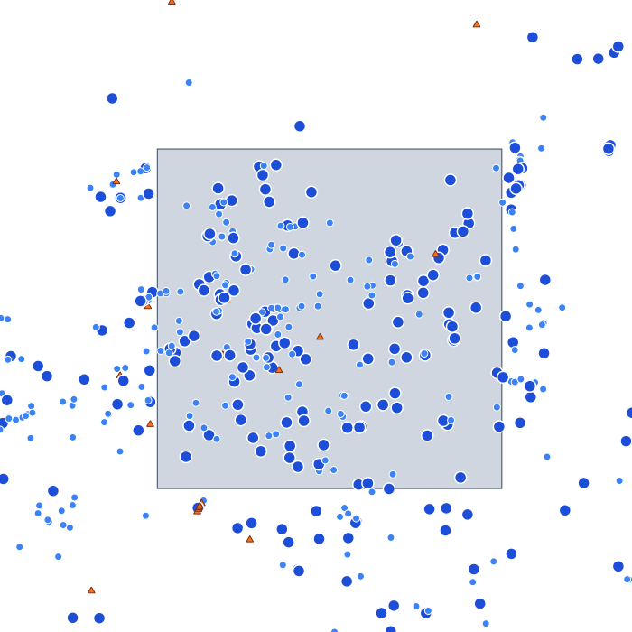
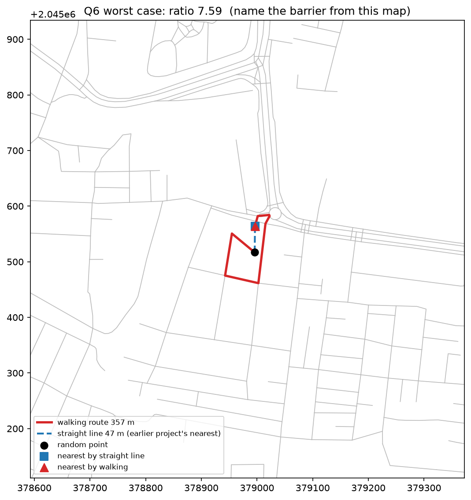
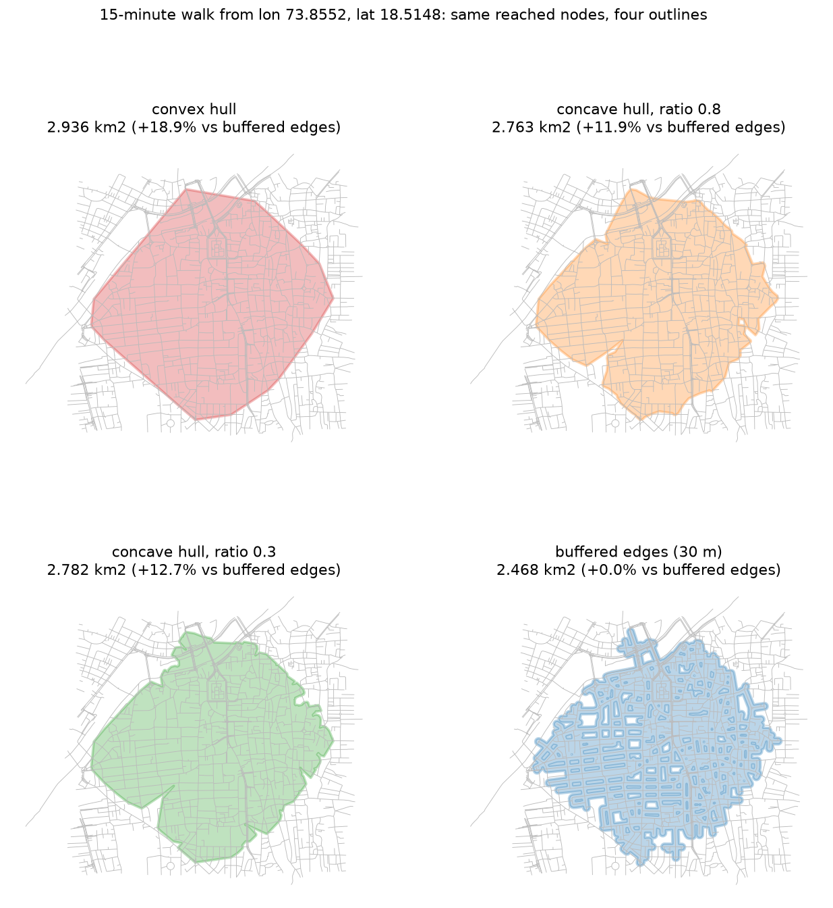

# ANSWERS

Every number below was produced by a command or script in this repository on the author's machine (raw output under
[`docs/evidence/`](docs/evidence/), maps and screenshots under [`docs/screenshots/`](docs/screenshots/) and
[`analysis/out/`](analysis/out/)). Re-run any block at the viva: `sh tools/collect_evidence.sh` reproduces Q1-Q5.

> **Before submitting:** the "Explain" paragraphs are drafts. The brief requires your own words - rewrite each one so you can
> defend it. Items marked **TODO (you)** need something only you can do (a site visit, a recording, the class sheet).

## Study set-up

| | |
|---|---|
| Area | Central Pune: bounding box 73.835-73.875 E, 18.495-18.535 N = 18.69 km^2 (UTM), covering 8 PMC admin wards. **TODO (you): make this match your class-sheet registration.** |
| Area type | city -> walking threshold **15 min = 1.2 km** (4.8 km/h = 80 m/min). 30 min / 2.4 km would apply to a taluka. |
| Service type | Healthcare. OSM tags counted: `amenity=hospital`, `amenity=clinic`, `amenity=doctors`, any `healthcare=*`. Polygon features reduced to one representative point. |
| OSM feature count | **243** points in the area after exact-duplicate removal, **223** after merging near-duplicates (same facility within 25 m). 432 in total incl. the 2 km margin. See Q3. |
| UTM zone / EPSG | zone = floor((73.855 + 180) / 6) + 1 = **43 N, EPSG:32643** |
| Earlier project | `legacy/` (the "Nearby location" Leaflet + Overpass app, plus the later PostGIS/GeoServer attempt). Repo link: **TODO (you)** |
| Population | **WorldPop 2020, 100 m, constrained** (people), clipped by `analysis/02b_prepare_worldpop.py`: 510,237 people inside the study area. Building footprints are used only for the "finest unit" row of Q7. |
| Ward data | PMC admin wards 2017 (DataMeet), clipped to the area by `analysis/02c_prepare_wards.py`. OSM has no ward or pin-code polygons here. |

---

## Phase 1

### Q1. One area, four areas
SQL: [`sql/02_q1_area.sql`](sql/02_q1_area.sql) - output: [`docs/evidence/q1_area.txt`](docs/evidence/q1_area.txt)

| Measure | Value | Unit |
|---|---|---|
| `ST_Area` on the 4326 geometry | 0.0016 | square degrees |
| `ST_Area` on `geography` | 18,700,377 | m^2 |
| after `ST_Transform` to UTM 32643 | 18,692,172 | m^2 |
| after `ST_Transform` to EPSG:3857 | 20,909,512 | "Web Mercator m^2" |
| ratio 3857 / UTM | **1.11862** | - |
| 1 / cos^2(18.515 N) | **1.11215** | - (1 / cos = 1.05458) |

**Explain (draft).** Degrees are angles, so the first number is not a size at all. Web Mercator stretches every length by 1/cos(latitude) and therefore every area by 1/cos^2(latitude), which is why the ratio is close to 1.112 (about 11 % too large at Pune). The remaining 0.6 % is also accounted for: Web Mercator uses a sphere (ellipsoid factor 1.00538) and UTM itself is scaled by k = 0.99978 at this longitude (k^2 = 0.99956), so 1.11215 x 1.00538 / 0.99956 = **1.11863**, matching the measured 1.11862. Use UTM (or `geography`) for any metric work. **Earlier project:** `legacy/src/facilities.ts` measured distance with the haversine formula on a sphere (R = 6371 km) directly from latitude/longitude, i.e. no projected CRS (the later `legacy/server` version cast to `geography`).

### Q2. Indexes and query plans
SQL: [`sql/03_q2_indexes.sql`](sql/03_q2_indexes.sql) - full plans: [`docs/evidence/q2_explain.txt`](docs/evidence/q2_explain.txt)
(223 in-area services x 12,835 buildings, `ST_DWithin(s.geom_utm, b.geom_utm, 500)`)

| Variant | Scan node on `buildings` | Execution time |
|---|---|---|
| (a) `ST_DWithin`, **no** GiST index | Parallel Seq Scan inside a Nested Loop; `Join Filter: st_dwithin(...)`, 1,357,078 rows removed | **1,043 ms** |
| (b) `ST_DWithin`, GiST index `buildings_geom_utm_gix` | **Index Scan** with `Index Cond: geom_utm && st_expand(s.geom_utm, 500)`, then `Filter: st_dwithin(...)` | **134 ms** |
| (c) `ST_Distance(a,b) < 500`, index present | Parallel Seq Scan again; `Join Filter: (st_distance(...) < 500)` | **1,014 ms** |

**Explain (draft).** `ST_DWithin` is rewritten by the planner into a cheap bounding-box test (`&&` against the box expanded by 500 m) that the GiST R-tree can answer, followed by the exact distance on the few survivors: about 8x faster here. `ST_Distance(a,b) < 500` is just a function result compared with a number, so the planner cannot see a bounding box, ignores the index and measures every pair - back to the slow plan even though the index exists.

### Q3. Data quality vs the earlier source
SQL: [`sql/04_q3_quality.sql`](sql/04_q3_quality.sql); baseline: `analysis/05_baseline_compare.py`; output: [`docs/evidence/q3_quality.txt`](docs/evidence/q3_quality.txt)

| Study area | before merging | after merging near-duplicates |
|---|---|---|
| services | 243 | **223** |
| without a `name` tag | 5 (**2.1 %**) | 5 (2.2 %) |
| pairs within 25 m | **44** | 24 |

The cleaning step ([`analysis/01_acquire_and_load.py`](analysis/01_acquire_and_load.py)) merged 20 same-facility pairs (same or near-identical name within 25 m, e.g. "Umarji Hospital" mapped twice 0.2 m apart as two nodes, "Meera Hospital" node + "Oyster And Pearl Meera Hospital" building). The list is in [`analysis/out/dedup_merged_pairs.csv`](analysis/out/dedup_merged_pairs.csv). The 24 pairs that remain are different practices in the same building (e.g. several doctors' clinics), which are real separate services.

**Comparison with the earlier project's data** (`analysis/05_baseline_compare.py`, output in [`docs/evidence/q3_baseline_compare.txt`](docs/evidence/q3_baseline_compare.txt); the earlier project's Overpass snapshot `legacy/response.json`, 20 Oct 2026, same bounding box and the same tag definition):

| | earlier project's snapshot | this project (cleaned) |
|---|---|---|
| healthcare features in the area | **213** (4 without a name) | **223** (5 without a name) |
| in both | 193 | 193 |
| only in one of them | **20** only in the snapshot | **30** only in the new data |

All 20 "only in the snapshot" are the near-duplicates this project merged away (they exist in `services_raw`), i.e. the earlier data kept both copies of the same facility. Of the 30 "only in the new data", 12 are `doctors`, 7 `dentist`, 3 `alternative`, 3 `pharmacy`, 2 `centre`, 2 `clinic;hospital`, 1 `nursing_home`: tags the earlier project's hospital/clinic categories never requested (it selected only `amenity|healthcare = hospital|clinic`). It also showed an unnamed feature as "<category> nearby" instead of flagging it, and removed duplicates only when category, name and coordinates to 4 decimals (~11 m) were identical.

**Verification of five services against a second source - TODO (you).** Random sample from the cleaned table (re-draw with the last query of the SQL file if you prefer):

| osm_id | name | lat, lon | source used | correct / misplaced / closed |
|---|---|---|---|---|
| [n7651453412](https://www.openstreetmap.org/node/7651453412) | Chajed Hospital | 18.504510, 73.862819 | TODO | TODO |
| [n7044175339](https://www.openstreetmap.org/node/7044175339) | Chaitanya Stem Cell Center | 18.500019, 73.850398 | TODO | TODO |
| [n7651453327](https://www.openstreetmap.org/node/7651453327) | Shree Datta Clinic | 18.504769, 73.842890 | TODO | TODO |
| [n7651453326](https://www.openstreetmap.org/node/7651453326) | Sabane Hospital | 18.510703, 73.843434 | TODO | TODO |
| [n8257748847](https://www.openstreetmap.org/node/8257748847) | Dr Barve's The Bone and Joint Clinic | 18.510981, 73.836355 | TODO | TODO |

**Explain (draft).** Only 2 % of services lack a name, so name completeness is good here; the real data-quality problem is duplication - 44 close pairs among 243 points, 20 of them the same facility mapped twice. Counting before cleaning would have overstated supply by about 9 % (243 vs 223).

---

## Phase 2

### Q4. The axis-order trap
Capabilities: [`docs/evidence/q4_capabilities.xml`](docs/evidence/q4_capabilities.xml) (extract: [`q4_boundingbox.txt`](docs/evidence/q4_boundingbox.txt)); URLs: [`q4_urls.txt`](docs/evidence/q4_urls.txt)
```
<BoundingBox CRS="EPSG:4326" minx="18.4780996" miny="73.8167234" maxx="18.552553" maxy="73.890117"/>
```
The same four numbers in `BBOX` for both requests (`18.4780996,73.8167234,18.552553,73.890117`):

| `VERSION=1.1.1&SRS=EPSG:4326` | `VERSION=1.3.0&CRS=EPSG:4326` |
|---|---|
|  empty image (8,002 B) |  services drawn inside the study area (83,964 B) |

**Explain (draft).** WMS 1.1.1 always reads `BBOX` as `minLon,minLat,maxLon,maxLat`, so these numbers mean longitude 18.48-18.55 and latitude 73.82-73.89 - a place that is not on the map (latitude 73.8 is near the Arctic), hence an empty image. WMS 1.3.0 follows the axis order of the CRS definition, which for EPSG:4326 is latitude first, so the capabilities print `minx` = a latitude and the same numbers select exactly the study area.

### Q5. WFS with a filter, two formats
Standard FES 2.0 filter ([URL](docs/evidence/q5_fes_filter_url.txt)) - and the GeoServer shorthand used by `tools/collect_evidence.sh`:
```
http://127.0.0.1:8081/geoserver/webgis/ows?service=WFS&version=2.0.0&request=GetFeature&typeNames=webgis:services&resultType=hits&cql_filter=name_status='named' AND in_area=true
  ...&outputFormat=gml32                  (GML 3.2)
  ...&outputFormat=application/json       (GeoJSON)
```
Output: [`q5_summary.txt`](docs/evidence/q5_summary.txt), [`q5_named_services.gml`](docs/evidence/q5_named_services.gml), [`q5_named_services.geojson`](docs/evidence/q5_named_services.geojson)
```
numberMatched="218"          (the FES <Filter> version returns 218 as well)
GML 3.2 : 205.9 KB   first point: <gml:pos>18.5251 73.8696</gml:pos>      -> latitude, longitude
GeoJSON :  85.2 KB   first point: [73.8696, 18.5251]                     -> longitude, latitude
```
**Explain (draft).** 218 = 223 in-area services minus 5 without a name. GML 3.2 uses the authority axis order of EPSG:4326 (latitude first), GeoJSON is defined as longitude, latitude (RFC 7946) - the same trap as Q4 in a different format. GML is 2.4x larger because every feature repeats namespaces, element names and `srsName` where GeoJSON only has short keys.

---

## Phase 3

Run `python analysis/03_access_analysis.py` (or `sh tools/pyrun.sh analysis/03_access_analysis.py`); numbers: [`analysis/out/results.json`](analysis/out/results.json). Network = OSM walking graph (13,134 nodes), undirected, points snapped to the nearest node with the snap distance added.

### Q6. Straight line vs street network
[`q6_points.csv`](analysis/out/q6_points.csv) (30 random points, seed 42), [`q6_summary.json`](analysis/out/q6_summary.json)
```
different nearest service (straight line vs walking): 9 of 30
median ratio network / straight: 1.57        maximum ratio: 7.59
```
| Case | straight | walking | ratio | barrier on the line (OSM lookup) |
|---|---|---|---|---|
| **Longest extra walk** (mapped below) | 470 m | 883 m | 1.88 | railway (w216122185), **river Mutha** (w23016562), stream Manik (w1304296304) |
| Largest ratio | 47 m | 357 m | 7.59 | none of river/rail/motorway/wall crosses it - a street-layout detour ([map](analysis/out/q6_max_ratio_case.png)) |



**Explain (draft).** For 9 of 30 random points the service the earlier app would have shown as "nearest" is not the nearest one you can walk to; the median walk is 57 % longer than the straight line. In the mapped worst case the point and the service are on opposite sides of the Mutha riverbed with the railway, and the only way across is a long street detour; the OSM query confirms the river, a stream and a railway cross the straight line. **TODO (you): look at the map and confirm the barrier in your own words.** The earlier project ranked by haversine distance only, so it would have displayed the wrong nearest service in those 9 cases.

### Q7. Coverage and the MAUP
SQL: [`sql/05_hex_post.sql`](sql/05_hex_post.sql); by ward: [`q7_by_ward.csv`](analysis/out/q7_by_ward.csv). Population = WorldPop people (510,237 in the area), threshold 1.2 km.

| Unit | Population beyond 1.2 km |
|---|---|
| Network, every building (finest unit; weighted by footprint) | **0.88 %** |
| Network, H3 res 9 cells (0.1 km^2) | **0.48 %** (2,472 people) |
| Network, H3 res 8 cells (0.7 km^2) | **0.0 %** |
| Network, 8 admin wards (mean distance of the ward's population) | **0.0 %** (largest ward mean 648 m) |
| Straight-line buffers (res 9 / res 8) | **0.0 % / 0.0 %** |

Worst-served populated cell (res 9): **`8960885030fffff`** - about 571 people, 1,466 m from the nearest service.
Union of the services' 1.2 km areas: **13.70 km^2** by network vs **18.69 km^2** by straight-line buffer (the whole study area).

**Explain (draft).** The central area is well served, but the conclusion depends on the unit: 0.88 % at building level, 0.48 % at res 9 and nothing at res 8 or ward level, because a large unit averages a poorly-served corner with a well-served centre. This is the modifiable areal unit problem: the finer the unit the more of the gap shows, so a planner reading only the ward table would conclude "nobody is left out". Buffers hide the gap completely because a 1.2 km circle covers streets that are separated from the service by the river and rail line.

### Q8. Who is the model for?
At 3.6 km/h the 15-minute threshold shrinks from 1,200 m to 900 m. [`q8_newly_uncovered_r9.geojson`](analysis/out/q8_newly_uncovered_r9.geojson)

| Unit | beyond at 4.8 km/h | beyond at 3.6 km/h | coverage lost |
|---|---|---|---|
| H3 res 9 | 0.48 % | 1.36 % | **0.88 percentage points** |
| H3 res 8 | 0.0 % | 1.35 % | **1.35 percentage points** |

Where: 4 res-9 cells newly fall outside - `8960885050fffff` (~2,673 people, 938 m from Synergy Dental Clinic), `89608850303ffff` (~1,017, 1,109 m, Naydu Rugnalay), `8960885033bffff` (~492, 1,152 m, Sancheti Hospital) and `89608850307ffff` (~291, 1,063 m, Kawediya Hospital).

**Explain (draft).** Slower walkers lose about 1 percentage point of coverage, almost triple the uncovered share, and the loss is concentrated in a few cells on the edge of the area near the river/rail corridor - a 4.8 km/h model under-reports the need of elderly residents.

---

## Phase 4

### Q9. Three ways to ship the same map
Measured with the Chrome DevTools Protocol (same data as the Network tab), cache disabled, 1400x900 viewport, median of 3 runs: `node tools/measure_network.mjs q9 http://127.0.0.1:4174` (raw: [`analysis/out/q9_network.json`](analysis/out/q9_network.json)). Reproduce by hand with the URL presets `/?z=12&bld=wms`, `/?z=14&bld=wfs`, `/?z=16&bld=mvt`. "KB" = transferred (decoded size in brackets); time = first buildings request to last byte. 12,835 buildings, everything on `127.0.0.1`.

| Buildings as | z12 req / KB / s | z14 req / KB / s | z16 req / KB / s |
|---|---|---|---|
| (a) tiled WMS PNG | 28 / 167 / 0.87 | 28 / 905 / 2.10 | 24 / 884 / 0.78 |
| (b) one WFS GeoJSON | 1 / 542 (4,572) / 1.08 | 1 / 542 (4,572) / 0.90 | 1 / 542 (4,572) / 1.10 |
| (c) MVT from pg_tileserv | 12 / 337 (728) / 0.58 | 12 / 494 (945) / 0.60 | 8 / 159 (287) / 0.32 |

**Explain (draft).** WFS always ships the whole dataset (4.5 MB decoded, one request) no matter how far you zoom in - cheap here because the area is small, but it grows linearly with the number of buildings and the browser must parse it all, so it **breaks first** as the area grows (a city of 500k buildings would be roughly 175 MB). WMS cost follows the viewport: the number of PNG tiles and their rendering on the server (and the single GeoServer) grows with every user and zoom. Vector tiles send only what is in view and are cheapest at high zoom, so they scale best. Caveat: server and browser share one laptop, so real networks would make the large WFS download slower still. **Earlier project:** `legacy/src/facilities.ts` sent an Overpass `around:` query from the browser on every search and kept all results in React state; at city scale each search would return tens of thousands of elements in one response, hit the public API's rate limits and timeouts, and no data would be cached or indexed.

---

## Phase 5

### Q10. Image size
```
docker build -t webgis-client:full -f client/Dockerfile.single client      # single stage, node:22
docker build -t webgis-client:slim client                                  # multi-stage, nginx:1.27-alpine
```
Output and history: [`docs/evidence/q10_image_sizes.txt`](docs/evidence/q10_image_sizes.txt)
```
webgis-client   full   1.8GB       webgis-client   slim   79.7MB
```
`docker history webgis-client:slim` (largest first): nginx install `RUN set -x && apkArch=...` **38.7 MB**; Alpine root filesystem 8.5 MB; `RUN addgroup ... nginx` 5.4 MB; the built site `COPY /app/dist` 3.5 MB.

**Explain (draft).** The slim image is 23x smaller because the multi-stage build throws away the build stage: Node, npm, `node_modules` (104 MB in the full image) and the source never reach the final image, which is just Alpine + nginx + 3.5 MB of static files. Its largest layer is the nginx package install; in the full image the largest layers are the Debian build toolchain of `node:22` (619 MB, 213 MB, 194 MB) that a static site never needs at run time.

### Q11. Self-healing and state
Reproduce: `sh tools/q11_experiment.sh | tee docs/evidence/q11_timeline.txt`; full timeline: [`docs/evidence/q11_timeline.txt`](docs/evidence/q11_timeline.txt). Cluster: `kind create cluster --name webgis`, `kubectl apply -f k8s/` (namespace, Secret, PostGIS StatefulSet + PVC, client Deployment, Services). 5 tables loaded with `pg_dump | kubectl exec -i ... psql`.

| Run | `kubectl delete pod postgis-0` at | New pod `Running/true` at | Old -> new pod uid | `SELECT count(*) FROM services` before -> after |
|---|---|---|---|---|
| **PVC** (`k8s/02-postgis.yaml`) | 08:36:16.866 | 08:36:24.582 = **7.8 s** | `1d882ebb` -> `fbeebc78` | **432 -> 432** (data survives) |
| **emptyDir** (`k8s/experiments/postgis-emptydir.yaml`) | 08:36:34.498 | 08:36:42.223 = **7.8 s** | `3da76ec5` -> `b5a8e78a` | 432 -> `ERROR: relation "services" does not exist` (**everything lost**) |
| PVC manifest re-applied | - | - | - | **432** again (the old PVC still held the data) |

(The loop polls every 0.5 s and only accepts a pod with a **different uid** than the deleted one - the old pod still reports `Running/true` for a moment while it terminates, see line 14 of the timeline. The first version of my script missed this and reported a bogus 0.3 s; the numbers above are from the corrected script.)

**Explain (draft).** The StatefulSet controller notices the pod is gone and creates a new one with the same name (`postgis-0`) and the same PersistentVolumeClaim, so PostgreSQL restarts on the same disk and finds its data; with `emptyDir` the storage lives and dies with the pod, so a fresh empty database comes back. A database is a StatefulSet rather than a Deployment because it needs a stable identity and its own persistent volume per replica (and ordered start/stop), while a Deployment's pods are interchangeable and share nothing.

### Q12. Static vs server deployment
Public URL: **https://manasthepatra.github.io/pune-healthcare-webgis/** (built by the green workflow run). Measured on the live site with `node tools/measure_network.mjs q12 <url>` (raw: [`analysis/out/q12_network.json`](analysis/out/q12_network.json)); zoom 14, buildings drawn, cache disabled, median of 3 runs.
```
Request:   GET /pune-healthcare-webgis/data/map.pmtiles
           Range: bytes=789766-982288          ->  206 Partial Content, 188.2 KB
           (other requests: bytes=0-16383 -> 206 16.3 KB; bytes=707947-789765 -> 206 80.2 KB; ...)
Total for the view:   67 requests to map.pmtiles, 2,287 KB (2,274 KB decoded), 2.5 s
```
Like-for-like on the local server stack ([`q12_local_server.json`](analysis/out/q12_local_server.json): every pg_tileserv + pg_featureserv request for the same view): **32 requests, 569 KB transferred (1,185 KB decoded), 2.5 s**. (Q9's MVT row counts only the buildings layer: 12 requests, 494 KB.)

**Explain (draft).** The static site moves about 4x more bytes for the same picture: a PMTiles tile contains all layers (both hex resolutions, services and buildings) and its range requests are already compressed, while pg_tileserv builds and gzips only the layers the page asks for. Two things the server stack can do that the static site cannot: answer live questions (WMS/WCS of the DEM, WFS filters, the walk-time API with pgRouting) and serve fresh data straight from PostGIS without re-exporting and redeploying a file. The static site's advantage is that it costs nothing to run and has nothing to patch or crash - GitHub's CDN serves any number of viewers, and the whole thing is just files (it is also how the public URL works without a credit card).

---

## Bonus - live walking-isochrone API

Run: `docker compose up -d` (adds `routing_db` = PostGIS + pgRouting, and `api`), `sh tools/pyrun.sh analysis/06_load_routing_graph.py`, open http://127.0.0.1:8010/docs. Client: tick **"Click the map: where can I walk?"** (see [screenshot](docs/screenshots/bonus-walk-explorer.png)). A click calls `/isochrone` (pgRouting `pgr_drivingDistance` + a hull of the reached nodes) and `/nearest` (services ranked by walking time, in minutes); the slider changes the minutes. Walking speed 4.8 km/h.

```
GET /isochrone?lon=73.8552&lat=18.5148&minutes=15&hull=concave|convex|buffer
GET /nearest?lon=73.8552&lat=18.5148&k=5
```
**TODO (you): record the 2-minute demo** (the brief asks for a video; I cannot record one).

### B1. Latency
50 scripted random clicks inside the area (seed 42, 5 warm-ups not counted), run inside the Compose network: [`analysis/07_latency_benchmark.py`](analysis/07_latency_benchmark.py) -> [`b1_latency.json`](analysis/out/b1_latency.json)

| endpoint / mode | round trip p50 / p95 | database p50 / p95 | API + network p95 |
|---|---|---|---|
| isochrone, **first version** (`mode=naive`) | 511 / **1,059 ms** | 507 / 1,056 ms | 4.1 ms |
| isochrone, **optimised** (`mode=bbox`) | 116 / **225 ms** | 112 / 222 ms | 3.7 ms |
| nearest, first version | 111 / **146 ms** | 108 / 143 ms | 2.8 ms |
| nearest, optimised | 8 / **9.7 ms** | 5.7 / 7.3 ms | 2.6 ms |

**What changed (p95 down 79 % and 93 %).** (1) pgRouting is given only the edges near the click (`geom_utm && ST_Expand(click, distance + 100 m)`, GiST index) instead of the whole edge table (routing alone 47 ms -> 7 ms); (2) the concave hull - the real cost, ~490 ms for 1,000 nodes - is computed on nodes thinned on a grid of distance/12 (area +4 %); (3) `/nearest` searches 1.2 km, then 2.4 km, then the full radius and stops once k services are found. Profiling showed the database dominates; API and network add < 5 ms. Also found while debugging: on Windows the host name `localhost` added ~200 ms to every call (IPv6 attempt first) - the client uses `127.0.0.1`.

### B2. Two engines, one question
[`analysis/08_two_engines.py`](analysis/08_two_engines.py) -> [`b2_two_engines.json`](analysis/out/b2_two_engines.json): 10 random points, pgRouting `/nearest?k=1` vs the NetworkX/OSMnx result of Phase 3.
```
points differing by more than 10 %: 0 of 10       largest difference: 0.01 %       same nearest service: 10 of 10
```
**Explain (draft).** Nothing exceeds 10 % because both engines run on the same OSM graph (loaded from the same GraphML), treat it as undirected, snap points and services to the nearest node and add the same snap distance (the snap offsets printed in the JSON are identical). The causes the brief lists - graph simplification, edge snapping, one-way tags - are therefore absent by construction; differences would appear if pgRouting used a differently built graph (e.g. `osm2pgrouting`, directed one-ways) or snapped to the nearest *edge* instead of the nearest node. One real difference exists but does not matter: NetworkX keeps only the largest connected component, pgRouting loads all (the graph has a single component).

### B3. Hull choice
[`analysis/09_hull_comparison.py`](analysis/09_hull_comparison.py) -> [`b3_hulls.json`](analysis/out/b3_hulls.json); one 15-minute isochrone from (73.8552, 18.5148):

| Polygon | Area | vs buffered streets | Part not within 30 m of a reached street |
|---|---|---|---|
| convex hull | 2.936 km^2 | **+18.9 %** | 0.51 km^2 (17.2 %) |
| concave hull, ratio 0.8 | 2.763 km^2 | +11.9 % | 0.38 km^2 (13.9 %) |
| concave hull, ratio 0.3 | 2.782 km^2 | +12.7 % | 0.39 km^2 (14.1 %) |
| buffered edges (30 m) | 2.468 km^2 | - | 0 |



**Explain (draft).** The **convex hull misleads most**: it is a rubber band around the outermost nodes, so it claims 19 % more area than the streets can reach and wraps around the river/rail gaps and other places nobody can walk to in 15 minutes. The concave hulls are better but still about 12 % too generous (and the ratio parameter changes the outline surprisingly little here, with some self-touching results that had to be repaired). The buffered-edges polygon is the most faithful, at the cost of holes inside blocks (land more than 30 m from a street) and more computing (about 180 ms vs 3 ms for the convex hull in my profiling).
