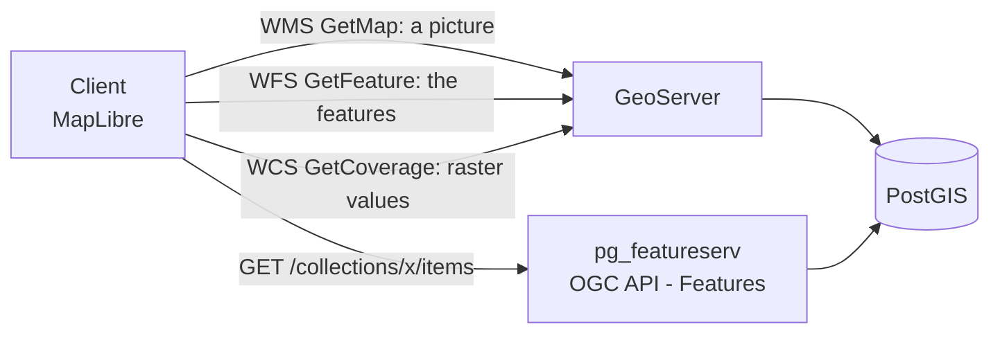

# S1 - OGC services and coordinate reference systems

> DRAFT scaffold. The brief requires notes **in your own words** and an oral check: rewrite each section after
> reading the primary sources (OGC WMS 1.3.0 / WFS 2.0 / OGC API - Features specs, PostGIS manual).

## WMS 1.1.1 vs 1.3.0 - the axis-order trap
| | 1.1.1 | 1.3.0 |
|---|---|---|
| CRS parameter | `SRS=EPSG:4326` | `CRS=EPSG:4326` |
| BBOX order for EPSG:4326 | `minLon,minLat,maxLon,maxLat` (always x,y) | `minLat,minLon,maxLat,maxLon` (the order the EPSG definition gives: lat first) |
| lon/lat without surprises | - | `CRS:84` (lon, lat) |

The same four numbers therefore describe **different rectangles** in the two versions (Q4). WMS 1.3.0 follows the
authority's axis order for every CRS; 1.1.1 predates that rule and always used x,y.

## WFS 2.0 with filters
`GetFeature` with `typeNames`, `count`/`startIndex` paging, `outputFormat`, `srsName`, and a `FILTER` written in
Filter Encoding 2.0 (XML), e.g. `PropertyIsEqualTo` on `name_status`, or the shorter `CQL_FILTER` (GeoServer extension).
`resultType=hits` returns only `numberMatched`. GML 3.2 with `urn:ogc:def:crs:EPSG::4326` is lat,lon; GeoJSON is always lon,lat.

## What WCS and OGC API - Features add
* **WCS** returns coverage *data* (e.g. elevation values, subsets, resampling), not a picture - needed for analysis on the DEM.
* **OGC API - Features** is the REST/JSON successor of WFS: `/collections`, `/collections/{id}/items?bbox=&limit=`,
  GeoJSON by default, links for paging, default CRS is CRS84 (lon, lat), so no axis-order trap.

## EPSG:4326 vs 3857 vs UTM
* **4326**: angles (degrees). `ST_Area` returns square degrees - meaningless as a size.
* **3857** (Web Mercator): metres, but scale grows as `1/cos(lat)`; lengths inflate by `1/cos(lat)`, **areas by `1/cos^2(lat)`**
  (about 1.05x in length and 1.1x in area at Pune's 18.5 N). Good for display, wrong for measuring.
* **UTM 43N (EPSG:32643)**: a transverse Mercator zone with scale factor 0.9996 on the central meridian; distortion < ~0.1 % inside the zone. Use it for distances and areas.
