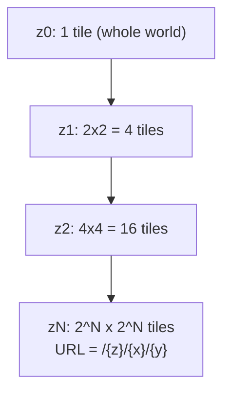

# S2 - Tiles and spatial indexes

> DRAFT scaffold - rewrite in your own words after reading the PostGIS manual (GiST / `&&`), the MVT spec,
> the PMTiles docs and h3geo.org.

## XYZ scheme
The world in Web Mercator is cut into `2^z x 2^z` square tiles; a tile is addressed by `z/x/y` (x from the west, y from the north).
Each zoom halves the ground size per pixel: about `156543 / 2^z` m/px at the equator (times `cos(lat)` at Pune).
Zoom 12 shows a city, 14 a neighbourhood, 16 individual buildings.

## Raster vs vector tiles
| | Raster (PNG) | Vector (MVT) | PMTiles |
|---|---|---|---|
| Content | rendered pixels | protobuf geometry + attributes, quantised to a 4096 grid | many tiles in **one file** (vector or raster) |
| Styling | on the server (SLD) | on the client (MapLibre style) - data-driven, hover, re-colour with no new request | same as MVT |
| Cost | server renders every tile | server (pg_tileserv) clips/encodes each tile | no server: client reads byte ranges with HTTP `Range` |

## GiST indexes and the bounding-box pre-filter
A GiST index is an R-tree over **bounding boxes**. A spatial predicate runs in two steps: (1) the cheap `&&`
bbox test using the index to discard far-away rows, (2) the exact geometry test on the survivors.
`ST_DWithin(a,b,d)` expands to `a && ST_Expand(b,d) AND exact distance`, so it can use the index.
`ST_Distance(a,b) < d` is just a function comparison, so the planner must compute the distance for every pair (Q2).

## H3 hexagons
H3 divides the globe into hexagons (plus 12 pentagons) with 16 nested resolutions (0-15, aperture 7). Every neighbour is the same distance away,
which is why delivery companies use it for aggregation. Res 8: edge about 0.53 km, area about 0.74 km^2. Res 9: edge about 0.20 km, area about 0.105 km^2 (H3 v4 values; older v3 tables list 0.46 / 0.17 km).
Cells are identified by a 64-bit index such as `89...fff`; a cell's parent/children give cheap roll-ups.
