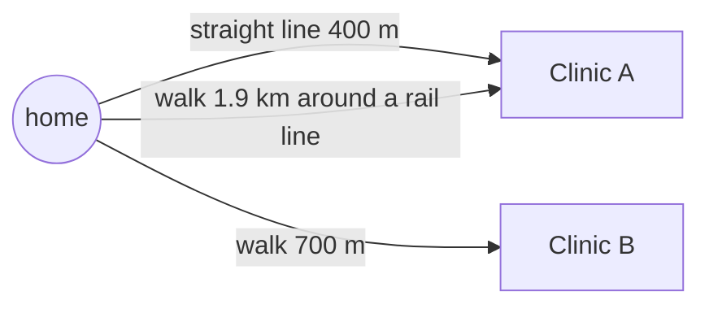

# S3 - Measuring access

> DRAFT scaffold - rewrite in your own words (sources: Fu & Sun 2011, Peng & Tsou 2003, OSMnx docs).

*The nearest service by straight line (A) is not the nearest by walking (B) when a barrier lies between.*

## Network vs straight-line distance
Straight-line (haversine / buffer) distance ignores the street layout. Network distance follows walkable edges, so it is always >= straight-line
(the *detour ratio*, Q6). Rivers, railways, expressways, gated campuses and hills push the ratio up and can change which service is nearest.

## Isochrones and walking speed
An isochrone is the area reachable within a time budget. Time = distance / speed: **4.8 km/h = 80 m/min**, so 15 min = 1.2 km (urban) and 30 min = 2.4 km (taluka);
**3.6 km/h = 60 m/min** gives 0.9 km (elderly walkers, Q8). A straight-line buffer of the same radius over-states coverage because it also covers land on the far side of barriers.

## Modifiable Areal Unit Problem (MAUP)
The same data give different statistics when aggregated by different zones: *scale effect* (res 9 vs res 8 vs wards) and *zoning effect* (where the borders fall).
A large unit averages a poorly-served corner with a well-served centre and can hide the gap (Q7). Report results at more than one unit and say which one you trust.
