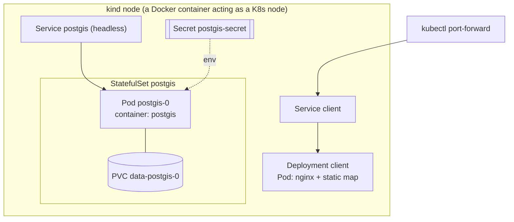

# S4 - Docker and Kubernetes

> DRAFT scaffold - rewrite in your own words (sources: Docker "Get started", Kubernetes Basics tutorial, Killercoda labs).

## Image vs container, layers, multi-stage
An **image** is a read-only stack of layers built from a Dockerfile (one layer per `RUN/COPY/ADD`); a **container** is a running instance
with a thin writable layer on top. Order instructions so rarely-changing layers (dependency install) come first and stay cached.
A **multi-stage build** compiles in a fat stage (Node + node_modules) and copies only the output (`dist/`) into a slim final stage (nginx:alpine) - Q10.
**Compose** describes several containers, one network and volumes in one file; services reach each other by service name.

## Kubernetes objects
| Object | Role |
|---|---|
| Pod | smallest unit: one or more containers sharing network + volumes |
| Deployment | keeps N identical, interchangeable pods running (stateless apps: the client) |
| StatefulSet | pods with stable names (`postgis-0`), ordered start/stop and **their own PVC** (databases) |
| Service | stable virtual IP/DNS in front of pods (headless = DNS only) |
| Secret | credentials kept out of images and manifests' pod specs (base64, not encryption) |
| PersistentVolumeClaim | a request for storage that outlives the pod |

## Self-healing and persistence
If a pod dies, its controller creates a replacement (Q11). A container's own filesystem is thrown away with it, so a database needs a PVC mounted at its data directory:
the new pod re-attaches the same volume and finds the data. A Deployment's pods are interchangeable and share/lose volumes arbitrarily; a StatefulSet gives each replica
a fixed identity and its own claim, which is what a database needs.
